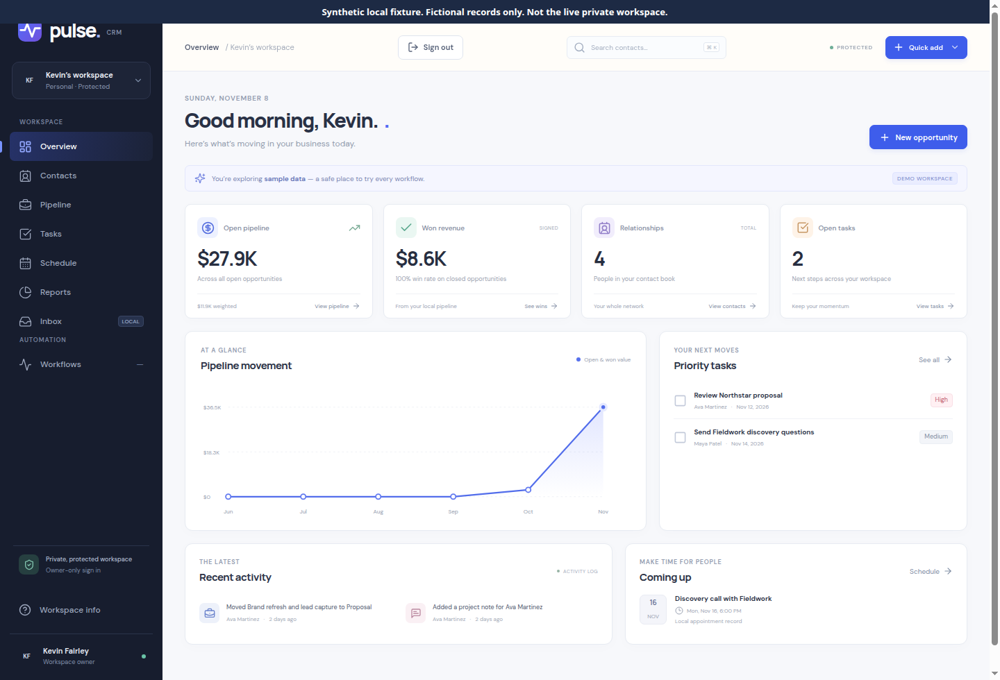
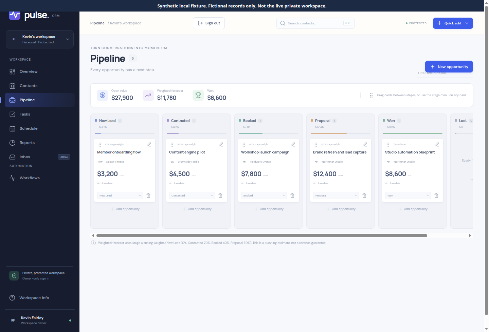
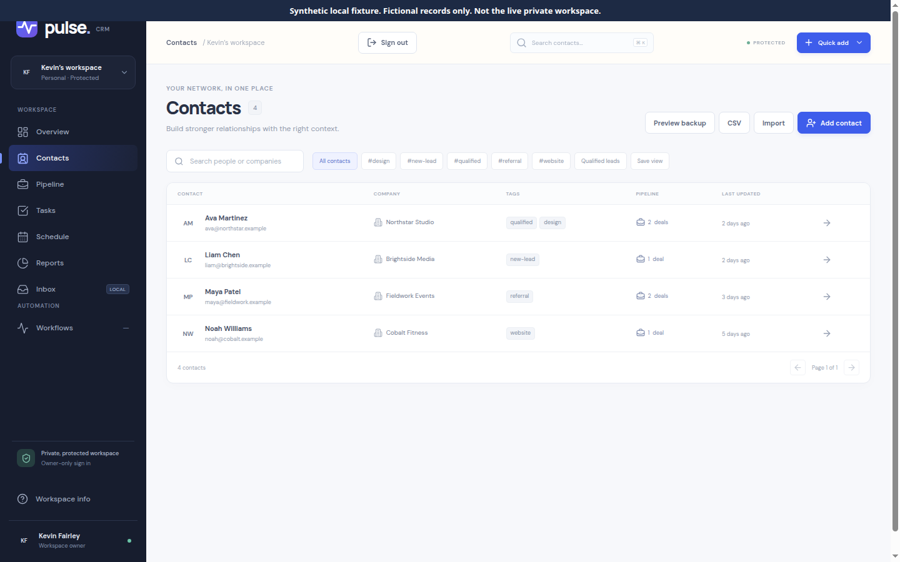
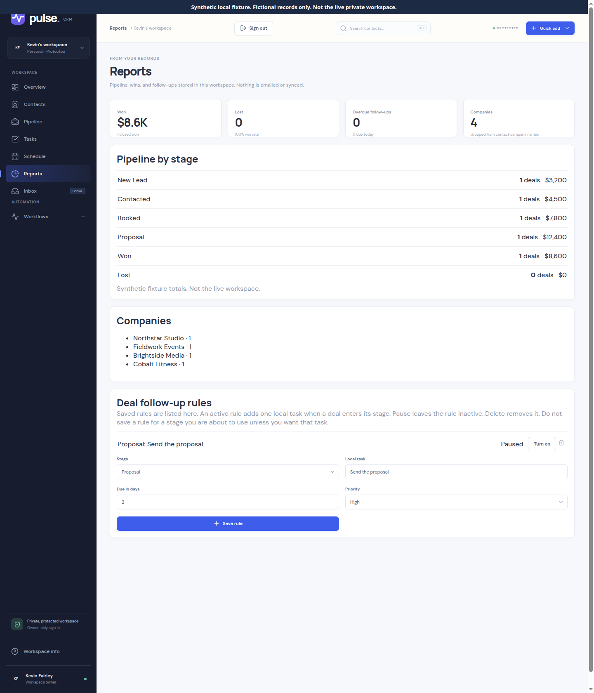
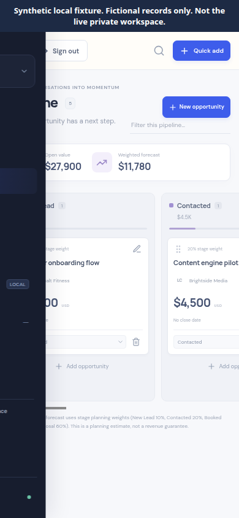

# Pulse CRM

Pulse CRM is an independent, single-owner workspace for contacts, a sales pipeline, follow-ups, and appointments. It exists so one person can keep that work in one private place without a paid multi-user CRM subscription and without connecting email, calendars, or other accounts.

The live site is [https://pulse-crm.kfairley9999.workers.dev](https://pulse-crm.kfairley9999.workers.dev). Sign-in is required. The workspace behind that sign-in is private. This repository does not include a demo account, owner credentials, a backup of live records, or customer data.

The application code in this tree is covered by 36 Node tests and 35 Workers tests (71 total). An approved Cloudflare upload of `deploy/cloudflare-upload/worker.js` — 467,053 bytes, SHA-256 `966a8b816eedc4173ff77acf4c68101dd7f99962c8815845ae384787ba7789a5` — was in progress when this README was written and is not claimed here as verified live. This documentation change does not redeploy or rebuild that file.

## Screenshots

These pictures are a **synthetic local fixture**. The people, companies, deals, tasks, and totals are fictional records served only to the browser for the screenshot. They are not the live workspace, not a production export, and not proof of a live phone pass. The dark bar on each image says so. The Overview also shows the product’s own “DEMO WORKSPACE” sample banner. The name in the sidebar is the workspace label baked into the client, not a customer record.












## What it does

- **Contacts.** Create, edit, search, and delete people. Tags, company, job title, and append-only notes. A blank Tags field means no tags. Saved views are stored filter chips. Company names are grouped on Reports. Each contact has a History tab of linked activity.
- **Pipeline.** Six stages: New Lead, Contacted, Booked, Proposal, Won, Lost. Values are USD, stored as integer cents. Cards can be dragged or moved from a stage menu, with explicit ordering. Open value and a weighted forecast are computed from the stored stages. The weights are a planning estimate, not revenue recognition.
- **Tasks.** Priorities, due dates, completion, and reopen. A task can repeat daily, weekly, or monthly. Completing it creates the next local task once. Choosing **Does not repeat** and saving removes that task’s repeat plan. The list and the edit form both show the saved choice.
- **Stage follow-up rules.** On Reports, a saved rule can add one local task when a deal enters a stage. Rules can be paused or deleted. With no rules, moving a deal does not create a task. Rules do not send email or call any other service.
- **Schedule.** Appointments have a duration, location, and notes. The browser converts the wall-clock time to an absolute instant before it is stored. Nothing is invited, synced, or dialed.
- **Reports.** Stage counts and values, won and lost totals, overdue follow-ups, and companies, all from records in this workspace.
- **Backup and CSV.** Preview backup shows counts, then downloads a JSON file. There is no restore button. Contact CSV export and a preview-then-commit import skip duplicate emails. A field that starts with `=`, `+`, `-`, `@`, tab, or carriage return is prefixed so a spreadsheet does not treat it as a formula. Password hashes, session tokens, and secrets are not exported.
- **Overview.** Open pipeline, won value, contact count, open tasks, a record-month chart, recent activity, and upcoming appointments. The chart is not a historical accounting ledger.
- **Inbox and Workflows.** Inbox reads and writes local contact notes. Workflows states that automations are not connected.

A new database starts empty. There is no automatic sample owner and no public demo login.

## What it is not

Pulse is not Salesforce and not a Salesforce replacement. It has no teams, roles beyond the one owner, lead assignment, products, quotes, forecasting hierarchy, AppExchange, or report builder.

It also does not:

- restore a JSON backup inside the app
- copy backups off the machine automatically
- sync email, contacts, or calendars
- send email, SMS, or calendar invitations
- run external webhooks or background jobs that send anything
- offer multi-factor authentication, password reset, or more than one owner
- promise a Free-tier CPU budget for every board size (large boards were not measured)

Back up the Cloudflare D1 database with the provider’s own export, on a copy you control, before treating the workspace as the only copy of business records. That export contains private CRM data and must stay out of this repository.

## Stack

| Piece | Role |
| --- | --- |
| React 19 and Vite | Static client |
| Cloudflare Worker | Native Fetch router, one ES module |
| Cloudflare D1 | SQLite database for the CRM, owner, sessions, and throttles |
| Workers Free | The intended plan. No KV, R2, Durable Objects, Queues, Workflows, or paid CPU limit |
| Browser PBKDF2-SHA256, 600,000 iterations | Derives the login credential on the device |
| Worker HMAC-SHA256 | Peppered verifier stored in D1. The pepper is a Cloudflare secret, not a file in this repo |

Node 22.13 or newer is only for building and testing. The deployed runtime is Fetch, WebCrypto, and D1.

`src/server/` is an older Express and `node:sqlite` app kept so the original API tests still run. It is not the deployment. Its password protocol is scrypt and is separate from the Worker’s browser credential. Legacy SQLite files are not imported into D1.

## Architecture

`src/worker.js` checks origin, authentication, and static files. `src/static-assets.js` serves an allowlisted set of hashed files, either from the `ASSETS` binding during local Wrangler or from the map embedded in `deploy/cloudflare-upload/worker.js` when that binding is absent. `src/crm.js` is the CRM API. `src/d1.js` prepares queries. `src/pipeline.js` orders cards. `src/auth/` handles the credential, session, CSRF, and throttles. `src/sales.js` holds backup, CSV, reports, saved views, follow-up rules, and task repeat plans. Those plans live in the existing `app_metadata` row `sales_workspace`. They do not add a schema migration.

`migrations/0001_initial.sql` is applied explicitly, never during a request. D1 batches commit a business write and its activity together. Pipeline compare-and-swap uses a nonce and a SQL check inside the write batch. A stale writer gets 409 and the batch rolls back. Reads that decide a write use a primary-first D1 session.

Anonymous `/` redirects to `/signin`. CRM APIs require an owner session. Cookies are `__Host-`, Secure, and SameSite Strict. The session cookie is HttpOnly. Writes need same-origin JSON and a session CSRF token. Login and setup are throttled. The client never stores the derived credential.

The derived credential is password-equivalent. It must stay on HTTPS and out of logs and browser storage. This is not a PAKE and not a server-side memory-hard password hash. A person who has both the database and the pepper can guess offline. A compromised browser can capture a password.

Local secrets are placeholders in `.dev.vars.example`. Copy that file to `.dev.vars`, which Git ignores, and replace both placeholders with separate random 32-byte values you generate yourself. Do not reuse a production secret, and do not commit `.dev.vars`, `.env`, a database, or a backup. Production `AUTH_PEPPER` stays in Cloudflare’s secret storage. `SETUP_TOKEN` is a one-time bootstrap key and is removed after the owner exists. This repository does not contain those values.

## Phone layout

Below 760px the sidebar is off-canvas and opens from the menu button. Below 520px the page padding, type, and action row tighten. The stage report is a stacked list, so the deal count and value stay on the screen. Pipeline columns scroll sideways. The 390px screenshot above is that layout with fictional cards. It is not a capture from a phone on the live site.

## Local setup

```bash
npm ci
cp .dev.vars.example .dev.vars
```

Edit `.dev.vars` and replace `REPLACE_WITH_LOCAL_RANDOM_32_BYTE_BASE64URL` and `REPLACE_WITH_SEPARATE_LOCAL_RANDOM_32_BYTE_BASE64URL`. A local generator for a value you keep only on that machine:

```bash
node -e "console.log(require('node:crypto').randomBytes(32).toString('base64url'))"
```

Run that twice so the two secrets differ. Then:

```bash
npx wrangler d1 migrations apply pulse-crm --local
npm run build
npx wrangler dev --local --https --ip 127.0.0.1 --port 8787
```

Open `https://127.0.0.1:8787/signin`, accept the local certificate, and create a test owner with the local setup key from your `.dev.vars`. Secure cookies need HTTPS. Nothing in these commands deploys or talks to the live database.

`npm run dev` builds the client and starts Wrangler. `npm start` starts Wrangler. `npm run dev:legacy` and `npm run start:legacy` are the loopback Express app. `npm run reset:sample` reseeds that legacy local database only. Do not point it at business data or D1.

## Tests

```bash
npm test                 # build, 36 Node tests, then 35 workerd/D1 tests
npm run test:legacy      # Node tests only; run npm run build first so the bundle render test can read dist/
npm run test:worker      # build, then the workerd suite
npm run test:smoke       # local Wrangler HTTP checks, static-assets mode
npm run test:smoke:bundle
npm run check            # build, Wrangler dry-run, and the upload package; not a deployment
npm run validate         # npm test && npm run check
npm audit --audit-level=high
```

`npm run package:worker` rewrites `deploy/cloudflare-upload/`. Do not run it if you need the committed 467,053-byte file to stay byte-for-byte identical. Deployment steps, and the reasons they are manual, are in [DEPLOYMENT.md](DEPLOYMENT.md).

## How it was built

This repository was developed with AI coding assistance in Cursor. Commits list both the repository owner and the coding agent. The owner operates the Cloudflare account and the private workspace. This README describes the software in the tree. It does not claim an unaided personal implementation, a Salesforce-equivalent product, or a finished live verification of the upload that was still being released.

## Source map

`src/client/` React UI · `test/workers/` workerd coverage · `dist/` generated assets, not committed · `deploy/cloudflare-upload/` the multipart upload package · `wrangler.jsonc` local assets binding · `wrangler.bundle.jsonc` the no-assets package config · `wrangler.test.jsonc` tests only.
