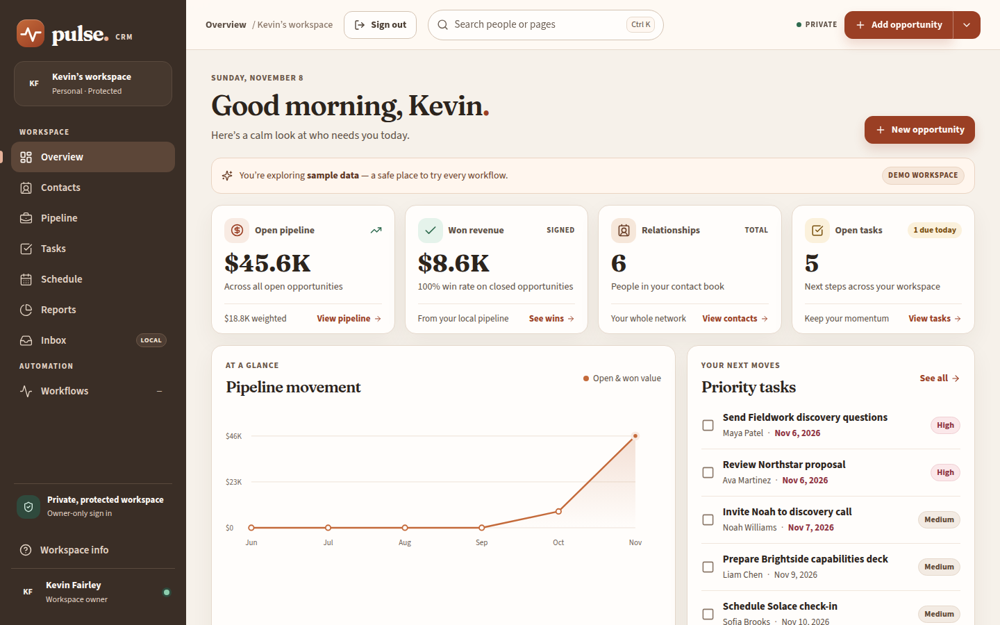
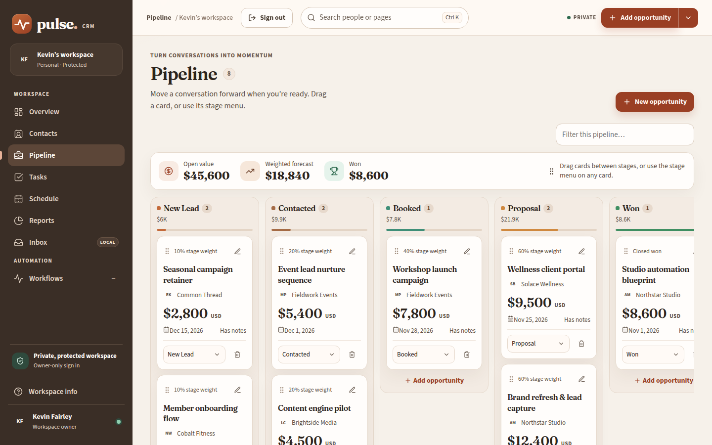
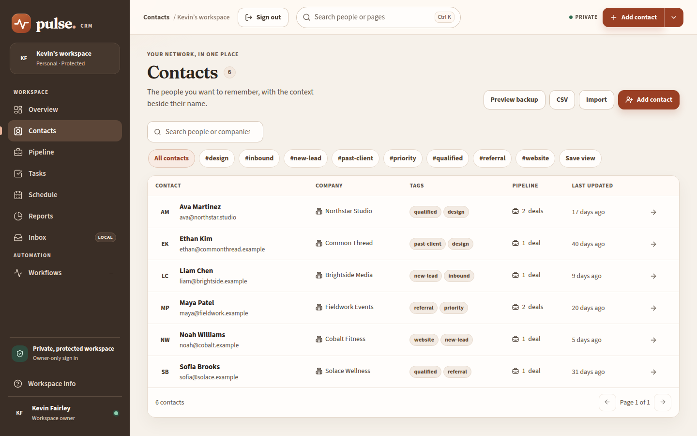
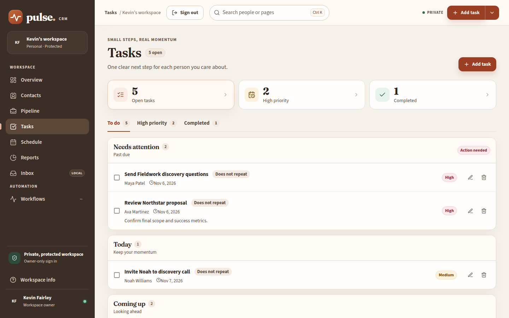
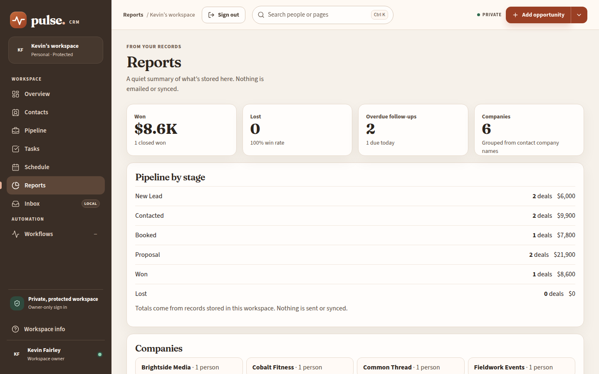
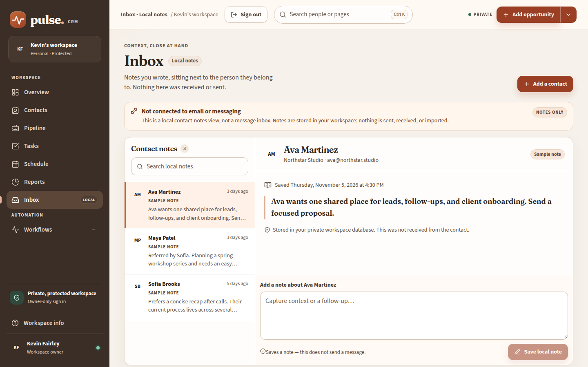
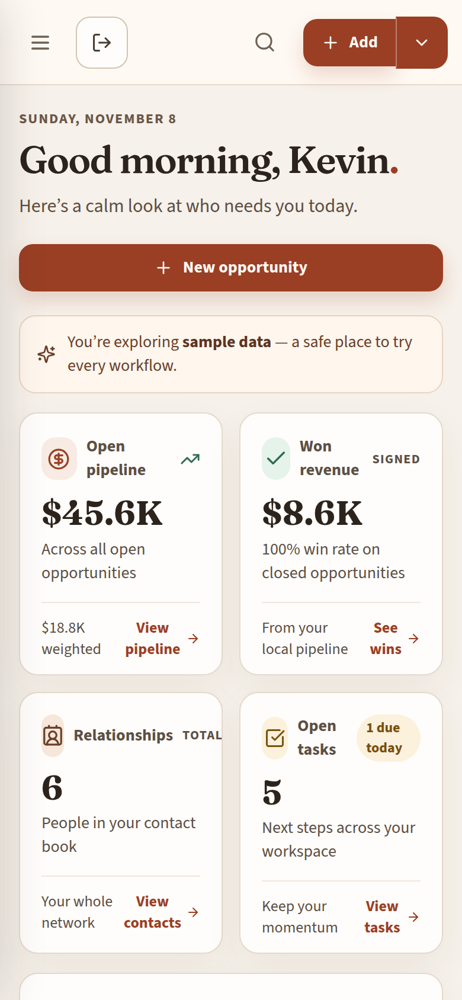
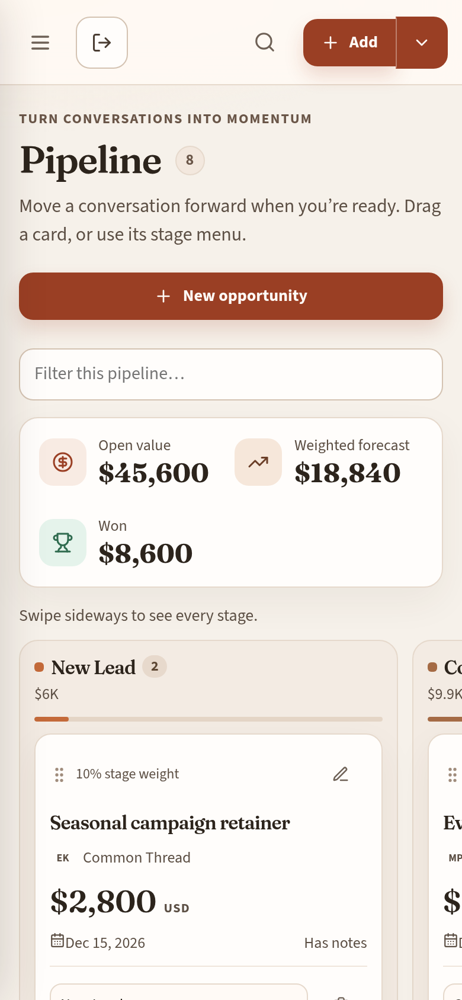
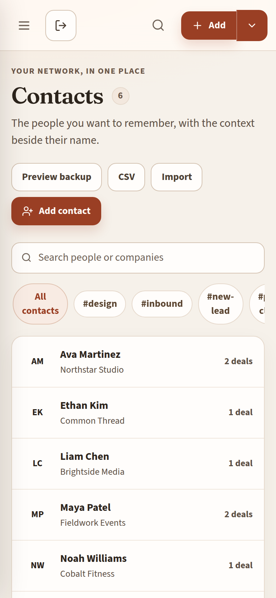
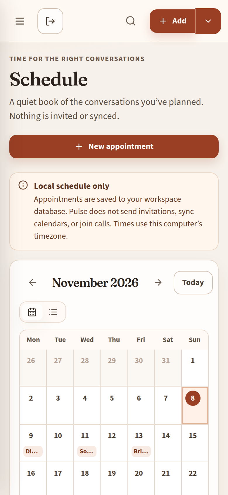

# Pulse CRM

Pulse CRM is an independent, single-owner workspace for contacts, a sales pipeline, follow-ups, and appointments. It exists so one person can keep that work in one private place without a paid multi-user CRM subscription and without connecting email, calendars, or other accounts.

The live site is [https://pulse-crm.kfairley9999.workers.dev](https://pulse-crm.kfairley9999.workers.dev). Sign-in is required. The workspace behind that sign-in is private. This repository does not include a demo account, owner credentials, a backup of live records, or customer data.

The application code in this tree is covered by 42 Node tests and 36 Workers tests (78 total). GitHub Actions runs `npm test` on pushes and pull requests. That job builds the client and runs the same suites. It has no secrets and it does not deploy.

`deploy/cloudflare-upload/worker.js` is the live script: 469,790 bytes, gzip 132,039, SHA-256 `da4def941eb1ba9963c16b9ac18303dbc09736e60fbcf9ac03c8903324e06e72`. The shell loads `/assets/index-tVPtbvvR.js` and `/assets/index-YHj8ZfeU.css`. It was uploaded November 7, 2026, at 7:57:46 PM Pacific. Deployment `97ad1b67-f257-4ffc-8cf4-9a0f0943bc61`, version `5c93bf48-e9de-4c8f-93a6-36bbe7930560`, rollout 100%. The script downloaded from Cloudflare matches that hash. `GET /api/health` returned 200. Anonymous CRM APIs returned 401. `AUTH_PEPPER`, the plain-text settings, the stored records, and the Free plan were left unchanged. `SETUP_TOKEN` is absent. `metadata.json` still keeps `secret_text` and `secret_key`. Signed-in browser acceptance is still in progress, so this is not a full live pass. No Free CPU or large-board measurement is claimed.

## Screenshots

These pictures are the redesigned client running against the **local sample database**. The people, companies, deals, tasks, and totals are fictional. They are not the live workspace, not a production export, and not a capture from a phone on the live site. The Overview shows the product’s own “DEMO WORKSPACE” sample banner. The name in the sidebar is the workspace label baked into the client, not a customer record. This change does not upload a new Worker; the package described above is still the script Cloudflare is serving.

The visual language is a warm studio: cream paper, an espresso sidebar, and terracotta actions. Headings are Fraunces and the interface is Source Sans 3, both served from this app so they load under the Worker’s font policy. Initials sit on clay, sage, honey, and blush. Empty states say what to do next, and saving or completing something confirms with a short toast.





















## A short tour

The pictures above are the fictional fixture, not the signed-in workspace.

1. **Overview** shows computed open pipeline, won value, contact count, and open tasks. The chart is pipeline value by the Los Angeles month of each record, not an accounting ledger. Recent activity is the workspace log.
2. **Pipeline** is six stages with drag-and-drop or a stage menu. Order is one compare-and-swap write. A stale writer gets 409 and the whole batch rolls back. The weighted forecast is a fixed planning weight per stage.
3. **Contacts** search, tags, saved views, CSV, and Preview backup live on one page. Open a person for notes, linked deals, and a History tab of the last 50 activities for that contact. Notes are append-only.
4. **Tasks** show whether a row repeats. Completing a repeating task creates the next local task once, keyed so a second completion does not duplicate it. Does not repeat deletes that plan.
5. **Reports** totals stages from stored deals and lists follow-up rules. A rule adds one local task when a deal enters its stage, once per rule and deal. Pause leaves the rule and stops new tasks. Delete removes it. Nothing is emailed.

## Calendar

The owner calendar is America/Los_Angeles. “Due in days,” task Today / overdue, Reports due-today, and the Overview month buckets use that calendar day. A date typed on a task is stored as that `YYYY-MM-DD` and is not shifted. Weekly repeat adds seven calendar days to the stored date, so Nov 8 stays Nov 15. Appointment entry converts the browser’s wall clock to an absolute instant; the tests pin that browser to America/Los_Angeles. Upcoming appointments are compared as instants, which is the right check for “has this time passed.”

A follow-up saved by the previous package at 7:45 PM Pacific on Nov 7 is still stored as Nov 9. The upload did not rewrite that row. A new rule uses the Los Angeles day. The existing row can be edited in the task form.

## What it does

- **Contacts.** Create, edit, search, and delete people. Tags, company, job title, and append-only notes. A blank Tags field means no tags. Saved views are stored filter chips. Company names are grouped on Reports. Each contact has a History tab of linked activity.
- **Pipeline.** Six stages: New Lead, Contacted, Booked, Proposal, Won, Lost. Values are USD, stored as integer cents. Cards can be dragged or moved from a stage menu, with explicit ordering. Open value and a weighted forecast are computed from the stored stages. The weights are a planning estimate, not revenue recognition.
- **Tasks.** Priorities, due dates, completion, and reopen. A task can repeat daily, weekly, or monthly. Completing it creates the next local task once. Choosing **Does not repeat** and saving removes that task’s repeat plan. The list and the edit form both show the saved choice.
- **Stage follow-up rules.** On Reports, a saved rule can add one local task when a deal enters a stage. The idempotency key is `ruleId:opportunityId` in `app_metadata.sales_workspace.spawned`, so entering the stage again does not add a second task. Pause sets `enabled` to false. Delete removes the rule. With no active rule, moving a deal does not create a task. Rules do not send email or call any other service. “Due in days” is counted from the Los Angeles calendar day.
- **Schedule.** Appointments have a duration, location, and notes. The browser converts the wall-clock time to an absolute instant before it is stored. Nothing is invited, synced, or dialed.
- **Reports.** Stage counts and values, won and lost totals, overdue follow-ups, and companies, all from records in this workspace.
- **Backup and CSV.** Preview backup checks the file shape and shows counts, then the browser downloads JSON. There is no restore button. Contact CSV export and a preview-then-commit import accept at most 100 rows. Rows whose email already exists are skipped and not overwritten. Invalid rows are reported and not inserted. A field that starts with `=`, `+`, `-`, `@`, tab, or carriage return is prefixed with a quote so a spreadsheet does not treat it as a formula. Password hashes, session tokens, and secrets are rejected from a backup preview and are not exported.
- **Overview.** Open pipeline, won value, contact count, open tasks, a record-month chart, recent activity, and upcoming appointments. The chart is not a historical accounting ledger.
- **Inbox and Workflows.** Inbox reads and writes local contact notes. Workflows states that automations are not connected.

A new database starts empty. There is no automatic sample owner and no public demo login.

## What it is not

Pulse is not Salesforce and not a Salesforce replacement. It has no teams, roles beyond the one owner, lead assignment, products, quotes, forecasting hierarchy, AppExchange, or report builder.

It also does not:

- restore a JSON backup inside the app
- copy backups off the machine automatically
- sync email, contacts, or calendars
- send email, SMS, or calendar invitations
- run external webhooks or background jobs that send anything
- offer multi-factor authentication, password reset, or more than one owner
- promise a Free-tier CPU budget for every board size (large boards were not measured)

Back up the Cloudflare D1 database with the provider’s own export, on a copy you control, before treating the workspace as the only copy of business records. That export contains private CRM data and must stay out of this repository.

## Stack

| Piece | Role |
| --- | --- |
| React 19 and Vite | Static client |
| Cloudflare Worker | Native Fetch router, one ES module |
| Cloudflare D1 | SQLite database for the CRM, owner, sessions, and throttles |
| Workers Free | The intended plan. No KV, R2, Durable Objects, Queues, Workflows, or paid CPU limit |
| Browser PBKDF2-SHA256, 600,000 iterations | Derives the login credential on the device |
| Worker HMAC-SHA256 | Peppered verifier stored in D1. The pepper is a Cloudflare secret, not a file in this repo |

Node 22.13 or newer is only for building and testing. The deployed runtime is Fetch, WebCrypto, and D1.

`src/server/` is an older Express and `node:sqlite` app kept so the original API tests still run. It is not the deployment. Its password protocol is scrypt and is separate from the Worker’s browser credential. Legacy SQLite files are not imported into D1.

## Architecture

`src/worker.js` checks origin, authentication, and static files. `src/static-assets.js` serves an allowlisted set of hashed files, either from the `ASSETS` binding during local Wrangler or from the map embedded in `deploy/cloudflare-upload/worker.js` when that binding is absent. `src/crm.js` is the CRM API. `src/d1.js` prepares queries. `src/pipeline.js` orders cards. `src/auth/` handles the credential, session, CSRF, and throttles. `src/sales.js` holds backup, CSV, reports, saved views, follow-up rules, and task repeat plans. Those plans live in the existing `app_metadata` row `sales_workspace`. They do not add a schema migration.

The D1 schema is one migration, `migrations/0001_initial.sql`. Tables: `contacts` (tags as JSON text), `contact_notes` (append-only, cascade on contact delete), `opportunities` (stage check, value in integer cents, `ON DELETE RESTRICT` so a contact with a deal cannot be deleted), `tasks` (`ON DELETE SET NULL`, completed status must match `completed_at`), `appointments`, `activities`, `board_state` (one row, monotonic revision), `users`, `sessions` (token and CSRF stored as hashes), `login_attempts`, and `app_metadata`. Indexes cover due date, stage position, session expiry, and activity time. Request handlers do not run DDL.

## Local automation

There is no queue, cron, or outbound integration. The only automation is inside the request that the owner just made:

- Moving a deal into a stage with an active rule inserts one task and one activity in the same D1 batch, then records the spawned key. A repeat of that move finds the key and inserts nothing.
- Completing a repeating task inserts the next open task once. The key is `seriesId|dueDate`. Saving Does not repeat deletes that task’s plan, so a later completion does not spawn.
- Import commit writes only the rows the preview marked create. A second commit of the same file creates nothing.

Workflows says automations are not connected. That page does not pretend to send mail.

`migrations/0001_initial.sql` is applied explicitly, never during a request. D1 batches commit a business write and its activity together. Pipeline compare-and-swap uses a nonce and a SQL check inside the write batch. A stale writer gets 409 and the batch rolls back. Reads that decide a write use a primary-first D1 session.

Anonymous `/` redirects to `/signin`. CRM APIs require an owner session. Cookies are `__Host-`, Secure, and SameSite Strict. The session cookie is HttpOnly. Writes need same-origin JSON and a session CSRF token. Login and setup are throttled. The client never stores the derived credential.

The derived credential is password-equivalent. It must stay on HTTPS and out of logs and browser storage. This is not a PAKE and not a server-side memory-hard password hash. A person who has both the database and the pepper can guess offline. A compromised browser can capture a password.

Local secrets are placeholders in `.dev.vars.example`. Copy that file to `.dev.vars`, which Git ignores, and replace both placeholders with separate random 32-byte values you generate yourself. Do not reuse a production secret, and do not commit `.dev.vars`, `.env`, a database, or a backup. Production `AUTH_PEPPER` stays in Cloudflare’s secret storage. `SETUP_TOKEN` is a one-time bootstrap key and is removed after the owner exists. This repository does not contain those values.

## Phone layout

Below 760px the sidebar is off-canvas and opens from the menu button. Body type stays readable, and icon controls grow to a 44px tap target. Contacts become cards, so the name, company, and deal count stay on the screen instead of a sideways table. Pipeline stages still scroll sideways, one column at a time, with a short swipe hint. The stage report stacks so the deal count and value stay visible. The phone pictures are that fixture in a 390px browser viewport. They are not captures from a phone on the live site.

## Local setup

```bash
npm ci
cp .dev.vars.example .dev.vars
```

Edit `.dev.vars` and replace `REPLACE_WITH_LOCAL_RANDOM_32_BYTE_BASE64URL` and `REPLACE_WITH_SEPARATE_LOCAL_RANDOM_32_BYTE_BASE64URL`. A local generator for a value you keep only on that machine:

```bash
node -e "console.log(require('node:crypto').randomBytes(32).toString('base64url'))"
```

Run that twice so the two secrets differ. Then:

```bash
npx wrangler d1 migrations apply pulse-crm --local
npm run build
npx wrangler dev --local --https --ip 127.0.0.1 --port 8787
```

Open `https://127.0.0.1:8787/signin`, accept the local certificate, and create a test owner with the local setup key from your `.dev.vars`. Secure cookies need HTTPS. Nothing in these commands deploys or talks to the live database.

`npm run dev` builds the client and starts Wrangler. `npm start` starts Wrangler. `npm run dev:legacy` and `npm run start:legacy` are the loopback Express app. `npm run reset:sample` reseeds that legacy local database only. Do not point it at business data or D1.

## Tests

```bash
npm test                 # build, 42 Node tests, then 36 workerd/D1 tests
npm run test:legacy      # Node tests only; run npm run build first so the bundle render test can read dist/
npm run test:worker      # build, then the workerd suite
npm run test:smoke       # local Wrangler HTTP checks, static-assets mode
npm run test:smoke:bundle
npm run check            # build, Wrangler dry-run, and the upload package; not a deployment
npm run validate         # npm test && npm run check
npm audit --audit-level=high
```

`.github/workflows/test.yml` runs `npm ci` and `npm test` on `ubuntu-latest`. It does not receive secrets and it does not deploy.

The calendar tests fix the clock: 7:45 PM and 7:47 PM Pacific on Nov 7, 2026 (`2026-11-08T03:45:00.000Z`) give due-in-0-days as Nov 7 and due-in-1-day as Nov 8. They also cover a July late evening, the March 8 spring-forward morning, and both sides of the Nov 1 fall-back. A Workers test checks that a stage rule’s saved due date equals `followUpDueDate`, and that Reports, Tasks, and the dashboard count yesterday as overdue and today as due today on the Los Angeles day. Weekly Nov 8 still asserts Nov 15.

`npm run package:worker` rewrites `deploy/cloudflare-upload/worker.js`. The committed file is the 469,790-byte package above. Deployment steps are in [DEPLOYMENT.md](DEPLOYMENT.md). Uploading it is a separate, explicit action. It is not part of `npm test`.

## How it was built

This repository was developed with AI coding assistance in Cursor. Commits list both the repository owner and the coding agent. The owner operates the Cloudflare account and the private workspace. This README describes the software in the tree. It does not claim an unaided personal implementation, a security audit, a load test, or a Salesforce-equivalent product. The live site is owner sign-in only. The screenshots are synthetic. The package above is the script Cloudflare is serving. Signed-in browser acceptance is still in progress. That check, and any Free CPU or large-board measurement, is not claimed here.

## Source map

`src/client/` React UI · `test/workers/` workerd coverage · `dist/` generated assets, not committed · `deploy/cloudflare-upload/` the multipart upload package · `wrangler.jsonc` local assets binding · `wrangler.bundle.jsonc` the no-assets package config · `wrangler.test.jsonc` tests only.
